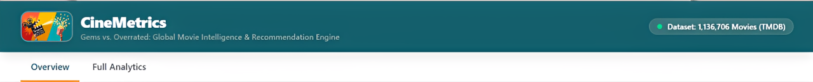
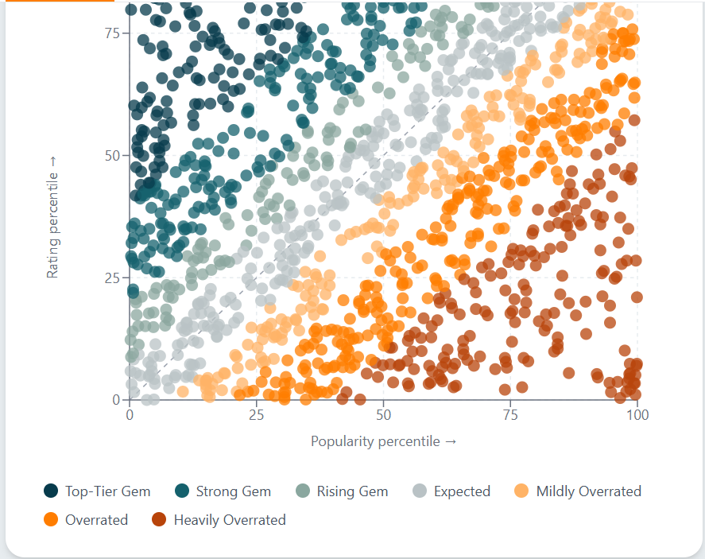
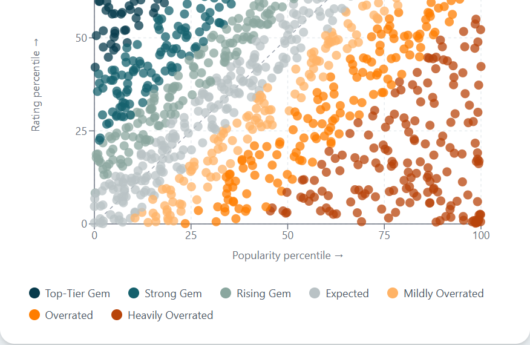
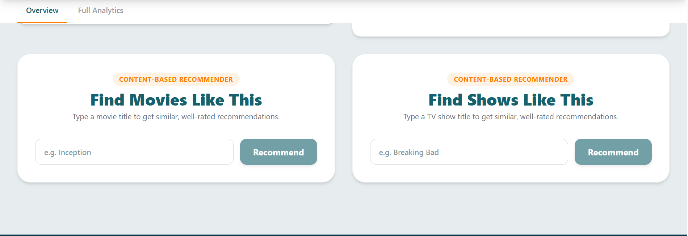
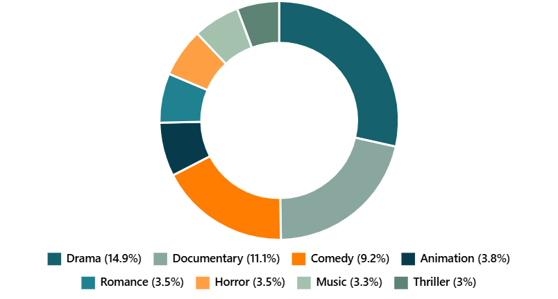
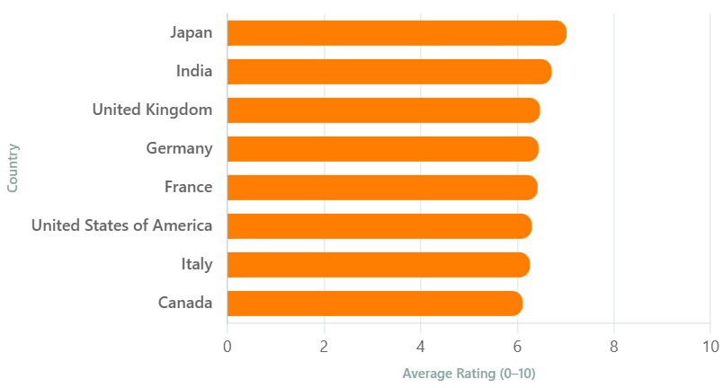
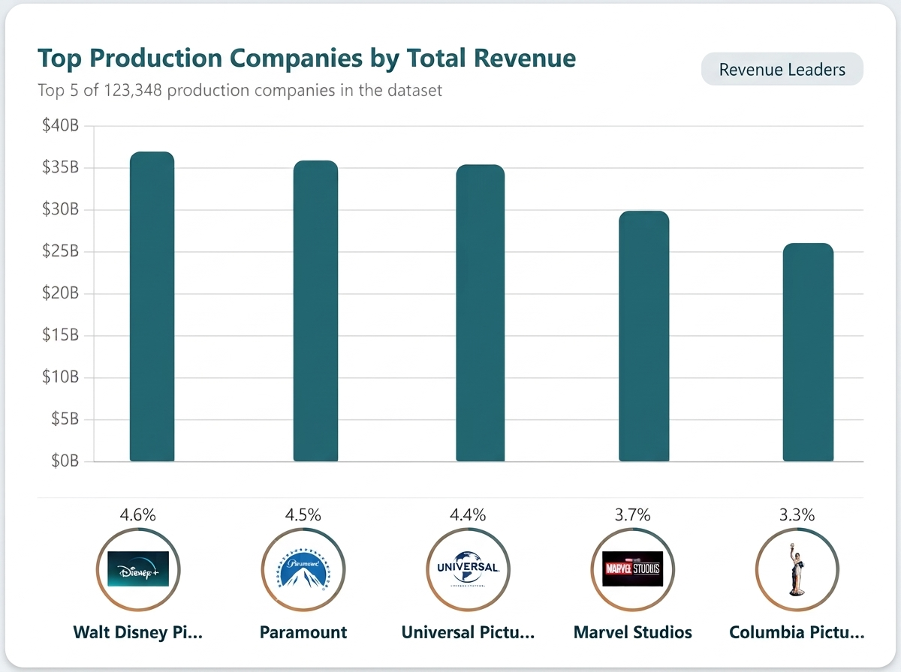
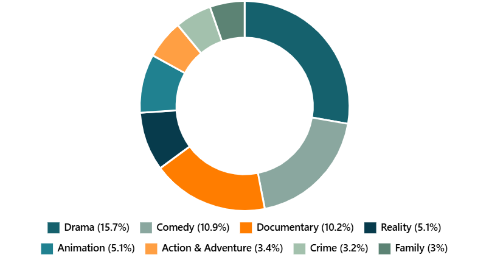
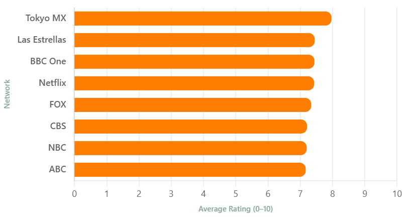
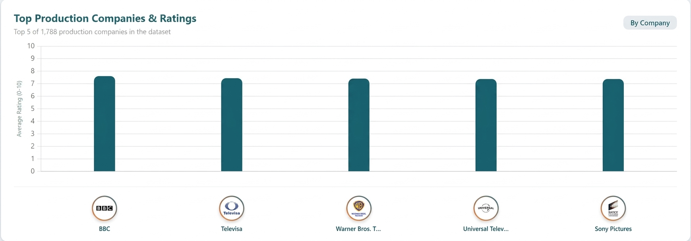

# 🎬 CineMetrics: Global Movie & TV Intelligence Dashboard




[](https://global-movies-dashboard.vercel.app/)
[](https://global-movies-backend.onrender.com)
[](https://global-movies-dashboard.vercel.app/)

<sub>*Note: The Render link serves as the backend API host and will return a "URL not found" or "Not Found" error if visited directly in the browser.*</sub>


## 📖 Overview

CineMetrics is a full-stack, cloud-native analytics platform that explores the global film and television industry. By analyzing over 1.1 million movies and TV shows from the TMDB dataset, it uncovers hidden gems, identifies overrated titles, and visualizes global box office and rating trends.

The platform features a custom, lightweight **Python Flask API** handling the backend orchestration and a sleek **React (Vite)** frontend client. It is engineered to run entirely on free-tier cloud infrastructure by decoupling heavy machine learning operations from the primary application server.

## ✨ Key Features

*   **📊 Global Analytics:** Interactive Doughnut and Bar charts visualizing genre distribution, top production companies, and country performance.
*   **💎 Cult Classics Scatter Plot:** A custom scatter plot identifying "Hidden Gems" (high rating, low popularity) vs. "Overrated" titles.
*   **🎯 Recommender:** A typo-tolerant search engine that finds similar movies/shows based on plot, cast, and crew metadata.
*   **📥 PNG Export:** Download any chart directly as a high-resolution PNG.
*   **⚡ Ultra-Low Memory Footprint:** Engineered to run on free-tier hosting by moving heavy 5GB ML operations to serverless cloud vector engines.

## 🖼️ Application Showcase

| 1. The Movie Scatter Plot | 2. The TV Scatter Plot | 3. The Recommender Interface |
| :---: | :---: | :---: |
|  |  |  |


## 📊 Analytics Deep Dive

CineMetrics exposes comprehensive industry aggregations across thousands of records, highlighting distribution volume, ratings parity, and revenue milestones.

### 🎥 Movie Intelligence Trends

| **Movies Genre Volume** | **Country Standings** | **Revenue Leaders** |
|:---:|:---:|:---:|
|  |  |  |
| **Drama rules the catalog** at **14.9%**, followed by **Documentaries (11.1%)** and **Comedies (9.2%)**. | **Japan and India** lead critical rankings, sustaining a baseline well above **6.5 / 10**. | **Walt Disney Pictures** dominates the financial ceiling, clearing **$35B+** in total revenue. |

---

### 📺 TV Show Insights

| **TV Shows Genre Volume** | **Network Standings** | **Top TV Shows Production Houses** |
|:---:|:---:|:---:|
|  |  |  |

| **Drama (15.7%)** holds the volume crown, while **Reality (5.1%)** captures massive real estate. | Specialty syndicates like **Tokyo MX (~8.0)** closely outpace legacy networks like **Netflix**. | **BBC** and **Televisa** sit locked in a tight competitive tie, keeping **7+ ratings** parity. |


## 🧠 How the Recommender Works (In Simple Terms)

Have you ever finished a great movie and thought, *"I want to watch something exactly like that"*? That is what our recommender does.

When you type a movie title, the system grabs all the "metadata" for that movie—its genres, plot keywords, the studio that made it, and the original language. It then turns all of those words into a massive mathematical fingerprint (called a vector).

The system then searches through thousands of other movies to find the ones with the most similar fingerprints. Finally, it ranks the results so that a movie that is highly rated by real users will appear above a similar movie that is poorly rated. If you make a typo (like typing "Incepton" instead of "Inception"), our backend uses a fuzzy-matching algorithm to guess what you meant and finds the right movie anyway!

## 🏗️ System Architecture

To keep this project 100% free to host and incredibly fast, the application uses a decoupled, hybrid-cloud approach.

```text
[ User ] 
   │
   ▼
[ Vercel (React/Vite) ] ──(REST API)──▶ [ Render (Python/Flask) ]
                                               │
                        ┌──────────────────────┼──────────────────────┐
                        ▼                      ▼                      ▼
                 [ Supabase ]            [ Upstash ]            [ Pinecone ]
                 (PostgreSQL)          (Movie Vectors)        (TV Show Vectors)
                 - Metadata              - 1,536-dim            - 1,943-dim
                 - Analytics Cache       - Cosine Similarity    - Cosine Similarity
```

### Why this stack?

*   **Render (Gunicorn):** Hosts the lightweight **Flask API**. It handles network logic, coordinates relational DB queries, and queries our vector indexes.
*   **Vercel:** Hosts the build-optimized **React** frontend client globally via edge CDN servers.
*   **Supabase (PostgreSQL):** Acts as the primary relational database. It stores the 1.1M rows of movie/TV metadata and serves pre-computed analytics via JSON caching. Querying Supabase instead of loading a 5GB Parquet file into Python drops server RAM usage from 5GB to <200MB.
*   **Upstash Vector:** A serverless vector database that stores the mathematical embeddings for the 22,000 most popular movies. It handles the cosine similarity search for the Movie Recommender.
*   **Pinecone:** Another vector database (used instead of Upstash for TV) storing embeddings for the TV shows, keeping the two recommendation engines completely independent and avoiding free-tier quota limits.

## 🛠️ Tech Stack

### Frontend
*   React (Vite)
*   Tailwind CSS (Styling)
*   Chart.js (Data Visualization)

### Backend & Data
*   Python 3.11 / Flask
*   Supabase (PostgreSQL + JSONB Caching)
*   SQLAlchemy (Database ORM)
*   Scikit-Learn (TF-IDF Vectorization)
*   Upstash & Pinecone SDKs (Vector Search)

## 🌐 Production Cloud Deployment & Variables

The app architecture relies on secure, bidirectional environment cross-wiring between the client host (**Vercel**) and the server container (**Render**).

### 1. Backend Deployed on Render
To safely accept requests from your user interface, the live Render app needs access to your frontend domain to satisfy CORS requirements.
Configure the following variable in your **Render Environment Dashboard**:
```env
ALLOWED_ORIGINS=...
```

### 2. Frontend Deployed on Vercel
To consume the API endpoints, your client bundle needs to map backend calls to the live production server.
Configure these variables in your **Vercel Project Settings**:
```env
VITE_API_URL=https://onrender.com
VITE_API_BASE=https://onrender.com
```

## 🚀 Local Development Setup

Want to run this project locally? Follow these steps:

### 1. Clone the Repository
```bash
git clone https://github.com
cd global-movies-dashboard
```

### 2. Backend Setup
```bash
cd backend
python -m venv venv
source venv/bin/activate  # On Windows use: venv\Scripts\activate
pip install -r requirements.txt
```

Create a `.env` file in the `backend` folder and add your credentials:
```env
# Supabase Database (Metadata & Analytics)
SUPABASE_DB_URI=postgresql://postgres.your-id:password@://supabase.com

# Vector Databases (Recommendations)
UPSTASH_VECTOR_REST_URL=your_upstash_url
UPSTASH_VECTOR_REST_TOKEN=your_upstash_token
PINECONE_API_KEY=your_pinecone_key
PINECONE_TV_INDEX=tv-recommender

# External APIs
TMDB_API_KEY=your_tmdb_api_key

# Security & CORS (Local Client)
ALLOWED_ORIGINS=http://localhost:5173
```

Run the Flask server:
```bash
python app.py
```

### 3. Frontend Setup
Open a new terminal window or tab:
```bash
cd frontend
npm install
```

Create a `.env` file in the `frontend` folder:
```env
VITE_API_URL=http://localhost:5000
VITE_API_BASE=http://localhost:5000
```

Start the Vite development server:
```bash
npm run dev
```
The app will be available at `http://localhost:5173`.

## 📡 API Endpoints

The backend exposes the following REST endpoints:

| Method | Endpoint | Description |
| :--- | :--- | :--- |
| **GET** | `/api/health` | Health check for uptime monitors (no DB hit). |
| **GET** | `/api/summary-stats` | Overall dashboard KPIs (served from Supabase cache). |
| **GET** | `/api/cult-classics` | Scatter plot data for Hidden Gems & Overrated movies (Supabase). |
| **GET** | `/api/recommend?title={name}` | Returns 5 recommended movies (Upstash Vector). |
| **GET** | `/api/tv/recommend?title={name}` | Returns 5 recommended TV shows (Pinecone). |

## ⚠️ Troubleshooting Cloud Ecosystem Hurdles

Deploying microservice layouts on free hosting tiers comes with specific constraints. If things break, check these known issues and resolutions:

### 1. Render Spinning/Loading Initial Delays (Cold Starts)
*   **Symptom:** The frontend loads, but charts spin infinitely or show errors on the first visit after a period of inactivity.
*   **Cause:** Render puts free-tier Web Services to "sleep" after 15 minutes of zero traffic. Waking the container back up takes **50 seconds to 2 minutes**.
*   **Fix:** A dedicated uptime ping script or a free cron job tool (e.g., [Cron-Job.org](https://cron-job.org)) can target your `/api/health` endpoint every 14 minutes to keep the backend warm 24/7.

### 2. Strict CORS / Blocking Errors
*   **Symptom:** Console output reveals cross-origin blockades (`Access-Control-Allow-Origin` missing).
*   **Cause:** Your `ALLOWED_ORIGINS` environmental configurations do not precisely match the origins.
*   **Fix:** Ensure there are **no trailing slashes** on variable values (`https://...vercel.app`, not `https://`). When testing locally, make sure your Flask app maps strictly to your local Vite server port (`http://localhost:5173`).

### 3. Recommender HTTP 504 / Request Timeout 
*   **Symptom:** Querying recommendations on Vercel yields a gateway error timeout.
*   **Cause:** Free tier clusters on Pinecone or Upstash can drop connection tunnels under heavy traffic, or Render's internal gateway cancels transactions taking longer than 30 seconds.
*   **Fix:** Confirm vector indexes are active and haven't dropped due to inactivity quotas on your cloud database management layers.

## 🤝 Contributing

Contributions, issues, and feature requests are welcome! Feel free to check the [issues page](https://github.com).

## 📝 License

This project is **MIT** licensed. Data found on TMDB, and Kaggle. 

